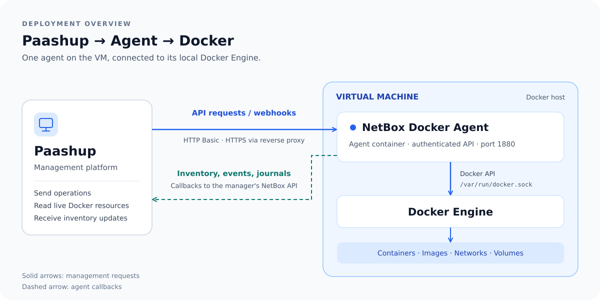

# NetBox Docker Agent

Manage a VM's Docker Engine from Paashup or the [NetBox Docker plugin](https://github.com/SaaShup/netbox-docker-plugin), with a local dashboard and API.



## User quick start

Requires Docker Engine and Docker Compose on the VM. From this checkout:

```sh
export DOCKER_GID=$(stat -c '%g' /var/run/docker.sock)
docker compose up -d --build
```

Open **http://localhost:1880** and sign in with `admin` / `saashup`.

Before exposing the agent, set `API_USERNAME`, `API_PASSWORD`, and `HEALTHCHECK_PASSWORD` (the plaintext API password), then recreate the container. Docker socket access grants control of the host; restrict access and use HTTPS through a reverse proxy.

Use **Agent settings** to connect to Paashup/NetBox, or register the endpoint from the plugin. The dashboard also works standalone. Registry lists stay synchronized with local images.

The agent stores configuration in the persistent `/data` volume. Follow logs or stop it with:

```sh
docker compose logs -f
docker compose down
```

For optional host SSH key management, follow the [SSH setup guide](docs/HOST-SSH-KEYS.md).

## Developer quick start

Requires Node.js 24 or newer and access to a Docker Engine.

```sh
npm ci
DATAPATH=./data npm start
```

The dashboard runs at **http://localhost:1880**. Open **http://localhost:1880/doc** for interactive API documentation.

```sh
npm run test:unit      # unit, integration, and security tests
npm run codeql:install # one-time local CodeQL installation
npm test              # also runs CodeQL, Docker compatibility, and browser tests
```

The full suite requires Docker Compose, privileged containers, and registry network access. See [development and testing](docs/DEVELOPMENT.md) for individual suites and test setup.

## Guides

- [Configuration and Paashup/NetBox connection](docs/CONFIGURATION.md)
- [API and dashboard operations](docs/OPERATIONS.md)
- [Pruning](docs/PRUNING.md)
- [Monitoring](docs/MONITORING.md)
- [Host SSH key management](docs/HOST-SSH-KEYS.md)
- [Development and testing](docs/DEVELOPMENT.md)
- [Migration from 1.x](docs/MIGRATION.md)
