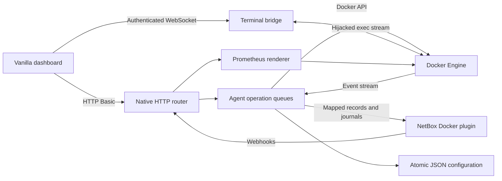

# Architecture

The service runs directly as Node.js ES modules. It has no flow runtime, host-shell subprocesses, web framework or frontend build step.

| Module | Responsibility |
| --- | --- |
| `src/index.js` | Startup, listen settings, signals and shutdown deadline |
| `src/server.js` | Explicit route dispatch, authentication, static asset allowlist, body limits and response envelopes |
| `src/auth.js` | Shared API Basic credentials for all routes, bcrypt compatibility and browser-origin checks |
| `src/agent.js` | Per-resource operation sequencing, inventory synchronization, callbacks, version checks and reconnecting Docker events |
| `src/mapping.js` | Explicit Docker/plugin field conversions, including full recreation options |
| `src/docker.js` | Engine transport selection, stream collection and disk-usage aggregation |
| `src/prune.js` | Strict prune scope/filter validation and direct Engine prune transport, including builder query options |
| `src/netbox.js` | HTTP/HTTPS callbacks, Token/Bearer selection, TLS checking, timeouts, journals and error counting |
| `src/config.js` | Legacy JSON imports, default settings, atomic serialized persistence |
| `src/terminal.js` | Authenticated upgrade, Docker exec hijack, stream framing, flow control, resize and shutdown |
| `src/recreate-helper.js` | Independent worker container for replacing the serving agent |
| `src/metrics.js` | The five historical metric families and escaped labels |
| `public/app.js` | Dashboard state and DOM operations; xterm is served locally as an ES module |

## Operation and failure semantics

A 202 response acknowledges receipt. Docker mutation and NetBox reporting happen afterward; they are separate operations. If a callback fails after Docker succeeds, the Docker operation remains applied. Errors are logged and a danger journal is attempted. Resource reads show the daemon's current state. Inventory refresh reconciles that state into NetBox.

Queues are in memory, as in the previous runtime. They are not a durable task broker. Keep the agent available until requested operations settle; a process restart can interrupt pending work. Shutdown stops new HTTP traffic and terminal sessions, closes the event stream, drains jobs and atomically saves configuration, with a 15-second deadline.

The new `POST /api/engine/:resource/prune` routes are synchronous and return Docker's report with HTTP 200 after completion. They accept direct options or the `data` envelope and share the existing API credentials and browser-origin checks. Queued resource requests and active mutations block pruning; mutations arriving during prune receive 409. Background event handling and periodic registry/manager refreshes remain tracked for shutdown without blocking pruning. Its promise is tracked for graceful shutdown. Host journal reporting is best effort, so a callback failure cannot turn completed deletion into a failed API response. Returned identifiers allow the caller to reconcile manager records; prune does not delete those records itself. See [pruning](PRUNING.md) for resource-specific defaults and filters.

Recreation pins the original container ID before renaming it. It stops and backs up the original, creates and starts the replacement, then removes the original. A failed creation/start restores the original name and running state. Self-recreation runs through a separate container so stopping the serving agent cannot interrupt the workflow.

Events reconnect after a broken stream. Ordinary lifecycle events are gated while an agent operation runs; pause/unpause remain synchronized, matching the legacy flow. NetBox lookup is scoped by host ID and container name, and only a unique result is updated.

## Compatibility and security boundaries

The public operational routes and plugin data fields are inventoried in `legacy-contract.json` and `FEATURE_PARITY.md`. Runtime/editor implementation settings are retired explicitly in `MIGRATION.md`. Endpoint writes retain asynchronous acknowledgments, and HTTP exec retains its historical text/plain JSON envelope and disabled-exec options echo.

Docker socket access is privileged host access. API credentials protect resource management, documentation, metrics and WebSocket upgrades. Administration has a separate identity. Browser-origin checks, explicit paths, bounded messages, text-safe DOM rendering and nonce-authorized terminal styles protect the web boundary. TLS certificate validation is enabled for NetBox unless explicitly disabled.

See `VALIDATION.md` for actual executed results and the remaining live NetBox verification boundary.
